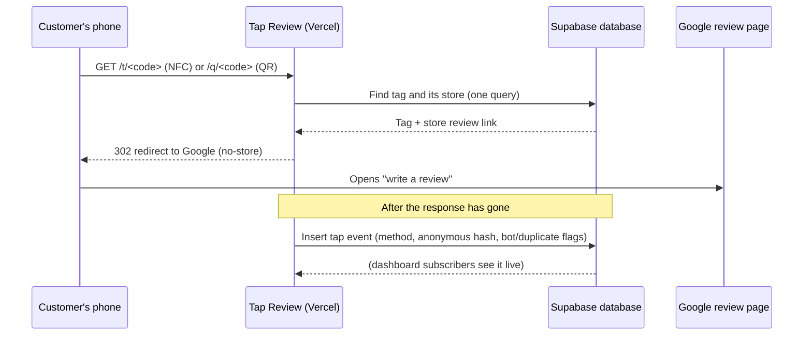

# 02 Architecture

Tap Review is one web app and one database. The app serves both the page a customer passes through in a split second and the dashboard managers use; the database holds the data and enforces who may see what.

## The parts

| Part | Choice | Why |
| --- | --- | --- |
| Web app | Next.js (App Router), React, strict TypeScript | One codebase for the customer redirect and the dashboard; free hosting on Vercel |
| Database | Supabase Postgres | Free tier, London region, built-in sign-in and live updates |
| Access control | Postgres Row Level Security | The database itself refuses forbidden reads and writes, even for someone calling its API directly |
| Live feed | Supabase Realtime, with 15-second polling as a fallback | New taps appear on screen within seconds |

## How a tap flows

If the tag or store is missing, switched off, or has no valid Google link, the customer is sent to a friendly "This card isn't active right now" page instead. Logging happens after the redirect so it can never slow the customer down.

## Key decisions

- **No page in between.** Straight to Google keeps the journey to one tap and keeps within Google's review rules.
- **Only the redirect writes taps.** No signed-in user, not even an admin, can insert tap events; only the redirect routes can, using the secret key.
- **Nothing identifying is stored.** A visitor is a salted SHA-256 hash that changes daily; raw IP addresses are never stored.
- **Totals are never stored.** City and area numbers are summed from stores when asked, so they cannot drift.
- **One setting for the public address**, `PUBLIC_APP_URL`.
