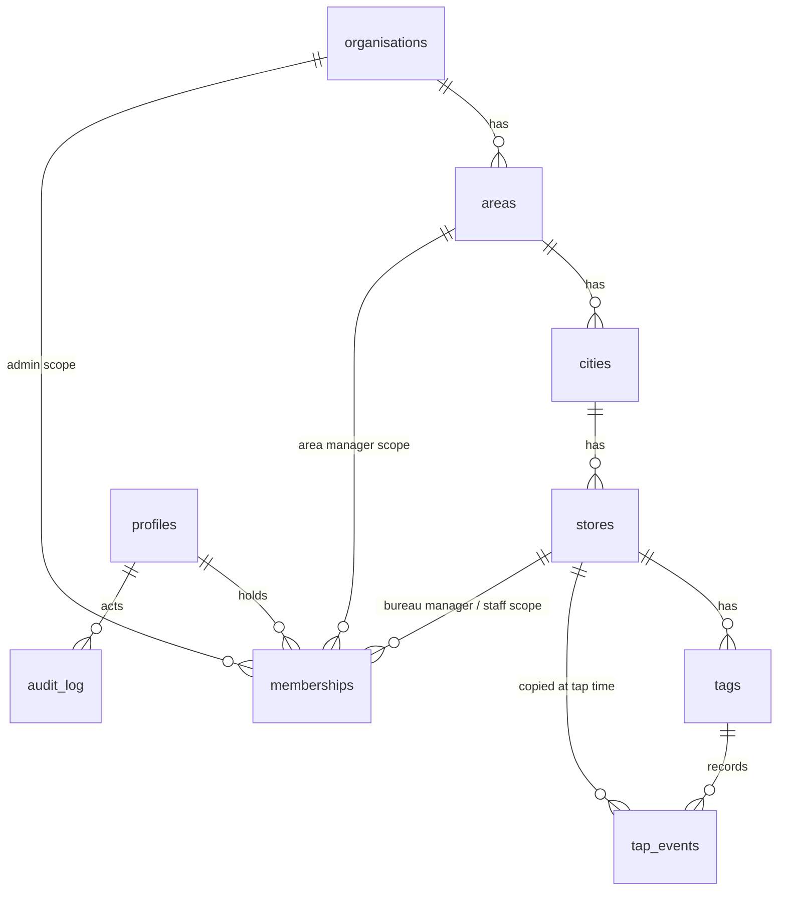

# 03 Database

This page lists every table and every access rule. The structure lives in `supabase/migrations/20261105000001_schema.sql`, the rules in `...000002_access.sql` and the reporting functions in `...000003_analytics.sql`.

## How the tables relate

## Tables

| Table | Holds |
| --- | --- |
| `organisations` | The company (Asda Travel Money for now) |
| `areas` | Area 1, Area 2 and so on |
| `cities` | A city inside one area |
| `stores` | One bureau with its own Google review link. Prefer switching off (`is_active`) to deleting |
| `tags` | One physical card. `public_code` is printed on it and can never change. Retiring a tag is permanent |
| `tap_events` | One row per tap or scan: tag, store (copied at the time), method, time, anonymous visitor hash, and flags for duplicate, bot and demo |
| `profiles` | One per login. Deactivating blocks access but keeps history |
| `memberships` | A user's role and scope: admin (organisation), area manager (an area), bureau manager or staff (a store) |
| `audit_log` | Who changed what; filled automatically by triggers |

Every table has Row Level Security switched on. Times are stored in UTC and grouped into days in Europe/London.

## Who can do what

| Table | Can read | Can change |
| --- | --- | --- |
| organisations | Any active signed-in user | Admin |
| areas, cities | Admin: all. Area manager: their areas. Others: those holding a store they can see | Areas: admin. Cities: admin, or area manager in their area |
| stores | Admin: all. Area manager: their areas. Bureau manager and staff: their stores | Admin; area manager in their area |
| tags | Same as the tag's store | Admin; area manager; bureau manager in their stores. Moving a tag needs rights over both stores |
| tap_events | Same as the event's store | Nobody signed in. Only the redirect, with the secret key |
| profiles | Yourself plus people in your scope | Your own name only. Email and active status are protected |
| memberships | Yourself plus memberships in your scope | Nobody directly. The invite and role actions use the secret key after checking you aren't granting a higher role or going outside your scope |
| audit_log | Admin: all. Area manager: entries tagged with their areas | Triggers only |

A deactivated user sees nothing, even with a valid login. Nobody can delete stores, tags or events from the API.

## Reporting functions

`analytics_totals`, `analytics_daily`, `analytics_by_store`, `analytics_hourly`, `analytics_by_tag`, `analytics_recent` and `analytics_today` run with the caller's own permissions, so a staff member asking for "everything" only gets their store. They skip duplicates and bots unless asked, and group days in London time.

## Extra safeguards added after the first draft

- **Store review links are limited to Google.** A database constraint refuses any `google_review_url` that is not an HTTPS link on a Google address (no look-alike hosts, no `google.com@evil` trick, no port). This holds even for someone calling the API directly.
- **Retiring a tag is permanent.** A retired tag cannot be un-retired or switched back on, and a printed code can never change.
- **Reading back what you just created.** Read rules for cities and stores also allow whoever manages the parent, so creating a city or store and getting it back in one step works for area managers.
- **Internal helper functions** are not callable through the public API, and trigger functions cannot be called at all.
